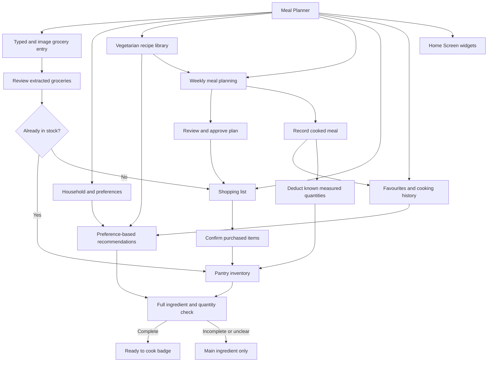
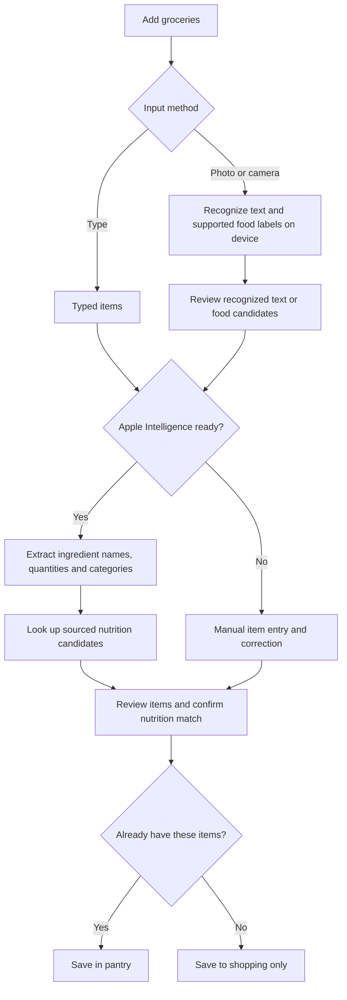
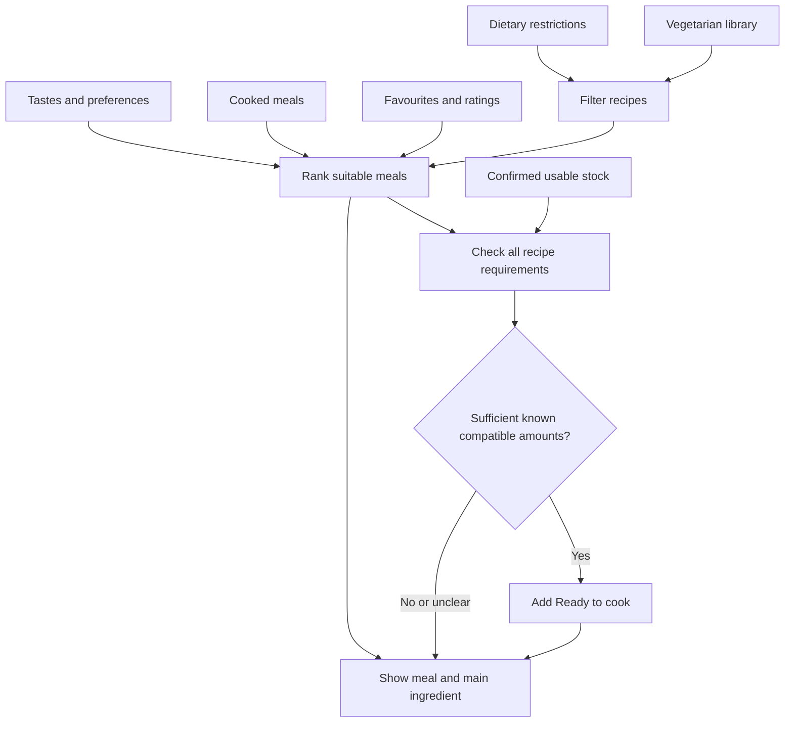
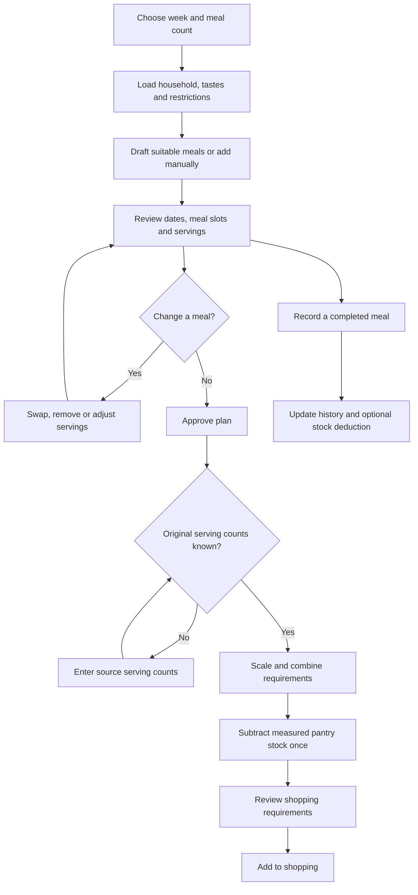
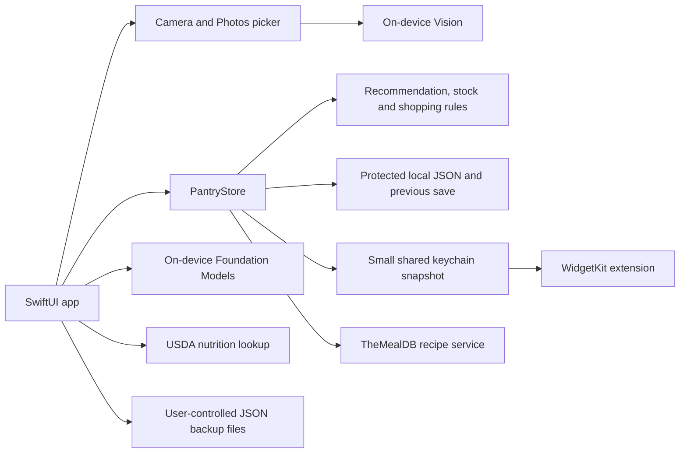

# Meal Planner development plan

Updated 11 November 2026 · Development build 0.2.0 (3)

This is the implementation checklist for the project’s [Mermaid planning chat](https://chatgpt.com/c/6af3188f-6f1c-83ec-95ab-8b7dbed3cc45), the Meal Planner marketing brief, and the development chat. Original synced references are preserved. This file tracks the app implementation.

## Confirmed decisions

- Native, private iPhone app developed in Xcode, with source history in private GitHub.
- Vegetarian food only. Eggs and dairy are included by default; profile restrictions can exclude them.
- Groceries can be entered by typing, choosing a photo, or using the camera. Image recognition requires review.
- A shopping item is not in stock. Only confirmed pantry stock counts toward cooking readiness.
- Recommendations follow the user’s preferences, favourites, feedback, and meal history. Pantry availability does not affect their order.
- Every recommendation shows the main ingredient. “Ready to cook” appears only when the full requirements can be matched to sufficient, current stock.
- Recommendations without complete stock show no missing-ingredient warning or shopping prompt. Shopping and substitution actions remain available inside a recipe.
- Costs and budgets are deferred at the user’s request on 11 November 2026. They do not affect the current screens or planning engine.
- Healthy eating is a product objective. A health scoring standard is not yet defined; no health score or health-outcome claim is generated.

## Master map

## Requirements and implementation

“Implemented” means source code is present and included in the app build. It does not imply that camera recognition, on-device AI quality, or widget rendering has passed hands-on iPhone testing.

| ID | Planned behaviour | Current implementation | Verification |
|---|---|---|---|
| MP-001 | Add groceries by images | Photo library and camera; on-device Vision text recognition and supported food-label suggestions; editable review | Signed build; hands-on recognition testing remains |
| MP-002 | Add groceries by typing | Manual entries and Apple Intelligence batch organization; quantities and categories editable before saving | Signed build; AI quality testing remains |
| MP-003 | Maintain in-stock inventory | Confirmed stock, quantities, use-by dates, out-of-stock state, purchase-to-pantry transfer | Automated stock and purchase checks |
| MP-004 | Recommend from eating history/preferences | Taste and cuisine preference fields, favourites, ratings, and logged meals influence ranking | Automated pantry-independence and restriction checks |
| MP-005 | Always show main ingredient | Recommendation cards and widget display the recipe’s first listed ingredient | Signed build; source ordering may need manual review |
| MP-006 | Ready only with full stock | Name aliases, compatible unit conversion, aggregate requirements, expiry and stock state checks | Automated sufficient/insufficient/unknown/expired stock checks |
| MP-007 | No missing prompt on recommendation cards | Cards and recommendation widget show main ingredient and optional readiness badge only | Source check and signed build; visual review remains |
| MP-008 | Recommendation independence | Ranking ignores groceries/shopping; availability affects only readiness | Automated changing-stock-order-invariance check |
| MP-009 | Profiles and household information | Household name/size, confidence, tastes, restrictions, equipment, maximum cooking time | Signed build; profile round-trip checks |
| MP-010 | Dietary requirements and allergies | Vegetarian enforcement, egg/dairy exclusions, common allergen aliases, custom ingredient exclusions | Automated restriction checks; cannot certify cross-contact |
| MP-011 | Weekly meal schedules | Date selection, 1–21 meal drafts, three meal slots, add/swap/remove meals, plan approval | Automated weekly draft and same-slot replacement checks |
| MP-012 | Serving adjustments | Original servings entered by the user; quantities scaled without inventing missing source servings | Automated factor and plan consolidation checks; unknown servings prompt |
| MP-013 | Recipe management | 86 sourced vegetarian recipes, offline catalogue, online updates, instructions, source links, user-entered recipe metadata | Catalogue integrity and signed build |
| MP-014 | Nutrition information | Sourced USDA ingredient facts; suggested food-match review; recipe links to matched ingredient facts | API response checked earlier; no fabricated recipe totals |
| MP-015 | Missing ingredients and substitutions | Measured deficits, shopping action in recipe detail, on-device AI alternatives restricted to suitable pantry items | Automated deficits; hands-on AI testing remains |
| MP-016 | Shopping list generation | Weekly ingredients combined, available measured stock subtracted once, preview before adding | Automated aggregation, deficit, and repeated-add checks |
| MP-017 | Purchased items | Check/uncheck purchases; explicit transfer to stock | Automated movement-to-stock check |
| MP-018 | Completed meals and feedback | Cooking log, optional measured-stock deduction, ratings, favourites, learned ranking | Automated deduction, duplicate-log prevention, history persistence |
| MP-019 | Freshness | User-entered use-by dates visible in pantry; expired entries excluded from readiness; earliest-dated stock consumed first | Automated expired-stock check; no invented expiry dates |
| MP-020 | Widgets | Shopping snapshot and preference-based recipe widget, with links to the app | Signed widget build; Home Screen testing remains |
| MP-021 | Data continuity | Migration from 0.1.x; JSON export/restore; previous-save recovery copy; unreadable data preserved | Automated migration and encoding round-trip |
| MP-022 | Development tracking | This checklist, Mermaid flows, Git commits, version/build labels | Source-controlled alongside implementation |

## Detailed workflows

### Grocery input

### Recommendations and readiness

### Weekly plan

## Architecture

## Deferred and open decisions

| Area | Status / next step |
|---|---|
| Costs and budgets | Deferred by user. Later: entered prices, line estimates, weekly budget handling and price provenance. No current recommendation or planning dependency. |
| Health criteria | Define nutrition standards before assigning recipe health scores. Sourced ingredient nutrition is available now. |
| Complete recipe nutrition | Needs reliable ingredient weights, source servings, density/portion conversions and full nutrient coverage. Current build does not invent totals. |
| Recipe catalogue growth | TheMealDB development access supplies the current vegetarian catalogue. Broader licensed data and a separately hosted custom backend require a source/hosting decision. |
| Household sharing | Household size is local profile data. Multi-device collaboration and account sync are not yet specified or implemented. |
| AI and image quality | Test real grocery lists, receipts, labels, and substitutions on the paired iPhone. User reviews remain part of the flow. |
| Widget interactions | Current widgets open the matching app screen. Inline purchase toggles can be added after validating cross-process update behaviour. |
| Waste/savings claims | Cooking counts are available. No quantified waste or financial savings are claimed without a measurement method. |

## Change log

- 0.1.0: initial pantry, recipe library, shopping and widget prototype.
- 0.1.1 (2): in-app version label and GitHub development workflow.
- 0.2.0 (3): implement the chart’s profiles, image entry, independent recommendations, stock checks, weekly plans, serving adjustments, consolidated shopping, cooking feedback, freshness and backups. Cost/budget work deferred at user direction. Source-controlled rule and migration checks added.

- 0.4.0 (5): added scrollable item-aware quantities, six original vegetarian Indian recipes, and targeted Indian vegetarian/vegan searches through TheMealDB.

## 0.5.0 decision update · 11 November 2026

Recipes is the first tab and opens on Discover. Groceries is accessed from the Recipes toolbar; Pantry and Shopping remain together. Selecting a recipe or adding it to a meal slot automatically combines all selected recipe requirements and subtracts pantry stock once, preserving manually added shopping entries. Plan shows a calendar above image-only morning, afternoon and evening slots. Seventeen recipes from iCloud Drive/Downloads/Meals are bundled with source servings where available. These decisions replace older navigation and shopping-preview descriptions above. Recipe photographs for the personal imports remain to be created.

## 0.6.0 decision update · 11 November 2026

The selected day’s morning, afternoon and evening are grouped in one section below the calendar. Recipe details have a prominent Add to meal plan action. Discover includes All, Breakfast, Snacks, Lunch and Dinner filters, with editable suggested classifications.
